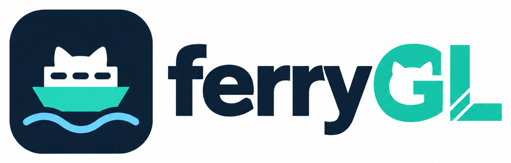

<p align="center">
  
</p>

# ferryGL

ferryGL copies the GitHub issues and pull requests you work on into your own Linear
workspace, and keeps their status up to date. It works in repositories you can read but
don't administer, using only your own credentials.

> **Status: early version (0.1).** `ferrygl check` and `ferrygl sync` work, and are tested
> with local fixtures and against a real GitHub repository.
>
> ferryGL is an independent project. It is not affiliated with or endorsed by Linear or GitHub.

## Why

You write code in someone else's GitHub organization (a client, a partner, an open-source
project), but your team plans its work in its own Linear workspace. Linear's GitHub
integration can't connect the two: an admin of the GitHub organization has to install it,
and an organization can connect to only one Linear workspace.

So you copy issues and pull requests into Linear by hand, and move their status as they
progress. ferryGL does that for you.

## What it does

Each time you run it, ferryGL:

1. **Finds your GitHub work** in the repositories you list: issues you created or are
   assigned to, pull requests you opened, and other people's pull requests you're assigned
   to, reviewed, were asked to review, or wrote commits for.
2. **Gives each item one Linear issue**, assigned to you and linked back to GitHub. A pull
   request you open for one of your issues joins that issue's Linear issue, so an issue and
   its fix are tracked once.
3. **Keeps the status in step with GitHub:**

   | On GitHub | In Linear |
   |---|---|
   | Issue open, or your review is requested | Todo |
   | Pull request in draft | In Progress |
   | Pull request open, or you've reviewed it | In Review |
   | Pull request merged, or issue closed as completed | Done |
   | Pull request closed unmerged, or issue closed as not planned | Canceled |

   An issue's Linear issue follows its pull request until the issue itself is closed. The
   [sync rules](docs/sync-rules.md#status-rules) cover every case, and the status names are
   configurable.

It's built to be safe in repositories that belong to someone else:

- **Read-only on GitHub.** It never comments, labels or changes anything there.
- **Preview first.** `ferrygl sync` only shows what it would do. `ferrygl sync --apply` does it.
- **Your edits win.** It moves a Linear status only when something changes on GitHub. If you
  move an issue by hand, it stays where you put it.
- **Nothing is deleted.** If an item leaves your scope, its Linear issue stays as it is.
- **Little is copied.** Titles, numbers, repository names, links and states. Descriptions
  only if you turn them on. Never comments or other people's names.

## How it works

ferryGL is a command you run by hand or on a schedule. It has no server and no database.

1. **Read GitHub.** For each *route* in your config (some repositories and the Linear team
   they go to), ferryGL searches GitHub once for each of your roles.
2. **Look up Linear.** It finds the Linear issues it made before by their links to GitHub, so
   running it again never creates duplicates. Before creating a new issue, it checks whether
   you already made one by hand that mentions the GitHub item, and links that one instead.
3. **Plan.** It compares GitHub with Linear and lists the changes: create an issue, link one,
   or move a status.
4. **Apply.** With `--apply`, it makes those changes in Linear.

On each Linear issue, ferryGL records the last GitHub state it acted on in the metadata of
the GitHub link. That's how it tells whether something changed on GitHub since the last run,
and why it leaves your own edits alone.

## Quick start

You need Python 3.11 or later, a GitHub account that can read the repositories, and a Linear
workspace.

1. Install ferryGL (or use `uv tool install ferrygl`, or `pip install ferrygl`):

   ```console
   $ pipx install ferrygl
   ```

2. Sign in to GitHub with the [GitHub CLI](https://cli.github.com/) (`gh auth login`), or set
   `GH_TOKEN` to a token that can read the repositories.

3. Create a personal API key in [Linear's API settings](https://linear.app/settings/api), and
   set `LINEAR_API_KEY` to it.

4. Write `~/.config/ferrygl/ferrygl.toml`:

   ```toml
   [[route]]
   repos = ["acme/api", "acme/web"]   # or "acme/*" for every repository of an owner
   team = "ENG"                       # Linear team key or name

   [sync]
   since = 2026-09-01                 # ignore items not updated since this date
   ```

5. Check the setup, preview the changes, then apply them:

   ```console
   $ ferrygl check
   $ ferrygl sync
   $ ferrygl sync --apply
   ```

   The preview lists each change:

   ```text
   acme/api#252  issue     update  ENG-7 Todo -> In Review
   acme/api#335  pr        link    -> ENG-7
   acme/api#348  involved  adopt   -> ENG-9
   3 changes (1 adopt, 1 link, 1 update). Run with --apply to make them.
   ```

[Getting started](docs/getting-started.md) walks through the same steps in more detail.

## Documentation

The documentation is also on the website, at https://oussamabatouche.com/ferryGL/.

| Page | What's in it |
|---|---|
| [Getting started](docs/getting-started.md) | Install, credentials, and a careful first run |
| [Configuration](docs/configuration.md) | Every setting in `ferrygl.toml` |
| [Sync rules](docs/sync-rules.md) | Which items are synced, how they map to Linear issues, and how statuses move |
| [Commands](docs/commands.md) | `check` and `sync`, reading the plan, exit statuses, schedules, troubleshooting |
| [Data and privacy](docs/data-and-privacy.md) | What ferryGL reads, what it writes to Linear, and what it keeps |
| [Architecture](docs/architecture.md) | How a run works inside, request costs, retries and limits |

## What it doesn't do

- Write anything to GitHub.
- Sync both ways, or keep descriptions and comments in sync.
- React instantly. There are no webhooks: Linear catches up each time ferryGL runs.
- Sync every issue in a repository for a whole team. Linear's GitHub integration does that
  when you can install it.

## Contributing

```console
$ uv sync
$ uv run pytest
$ uv run ruff check && uv run ruff format --check
```

Read [AGENTS.md](AGENTS.md) before changing ferryGL. It lists the rules that keep users'
data safe, and how changes are tested and reviewed.

## License

[MIT](LICENSE)
