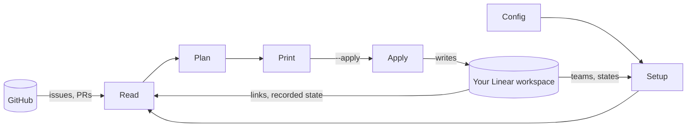

# Architecture

How a run works inside ferryGL, for people who want to understand or change it. Before
changing anything, also read [AGENTS.md](../AGENTS.md): it lists the rules that keep users'
data safe.

ferryGL is a small Python package in `src/ferrygl/`, with one runtime dependency, `httpx`.

## How data moves

ferryGL reads from GitHub and from your Linear workspace, plans in memory, and writes only to
Linear: with `sync --apply`, or with `watch` unless you add `--preview`. What a run writes to
Linear is what the next run reads back.

<!-- site: _runflow.html -->


## A run, step by step

1. **Load the config** (`config.py`) into frozen dataclasses. Any error stops the run with
   exit status 2.
2. **Find the Linear API key** (`cli.py`): `LINEAR_API_KEY`, else `[linear] api_key_file`.
3. **Resolve every route's Linear setup** (`sync.py`): the API key's owner, then each route's
   team, its workflow states, the project and the label. If anything is missing, stop with
   exit status 2 before reading GitHub.
4. **For each route:**
   1. **Read GitHub** (`github.py`): resolve the token, ask whose it is, and run one search
      per enabled role. Merge the results into one item per URL, keeping every role.
   2. **Read Linear** (`linear.py`): look up the links to every item's URL with
      `attachmentsForURL`. If an item has no Linear issue of yours yet, also load your issues
      in the route's team as candidates for adoption.
   3. **Plan** (`plan.py`): a pure function from the GitHub items, the Linear links, the
      candidates and the config to a list of changes. It does no I/O.
   4. **Print** the changes and, with `--apply` (or under `watch`, unless `--preview`),
      **make them** (`sync.py`, `linear.py`).
5. **Print a summary**, and exit with status 0, or 1 if a route or a write failed.

All reads for a route happen before planning, and all writes after it. That keeps the planner
pure and testable, and means `sync` without `--apply` runs every step of a real run except the
writes.

Shared types (`GitHubItem`, `LinearIssue`, `Attachment`, `Change`) live in `model.py`.

## State lives in Linear

ferryGL has no database. Each Linear issue it manages has a link (a Linear *attachment*) to the
GitHub URL, and the link's metadata records the GitHub state ferryGL last acted on. The keys
are listed in [Data and privacy](data-and-privacy.md#link-metadata).

- **Finding existing work.** Linear's `attachmentsForURL` query returns the links to a URL.
  ferryGL uses the one on an issue assigned to you. That's what makes reruns idempotent.
- **Deciding whether to move a status.** ferryGL compares `ferrygl_state` with the item's
  current state key. Only a difference moves the status, which is why manual edits survive.

The state keys come from `github_state` in `plan.py`:

| Kind | State keys |
|---|---|
| `issue` | `issue:open`, `issue:open:pr_draft`, `issue:open:pr_open`, `issue:open:pr_merged`, `issue:closed:completed`, `issue:closed:not_planned` |
| `pr` | `pr:draft`, `pr:open`, `pr:merged`, `pr:closed` |
| `involved` | `involved:requested`, `involved:reviewed`, `involved:draft`, `involved:open`, `involved:merged`, `involved:closed` |

These keys, like the metadata keys, are stored in users' workspaces, so they're a
compatibility contract: renaming one would make every recorded link look changed.

## Watching

`ferrygl watch` (`watch.py`) repeats runs rather than changing them. GitHub reports changes
as they happen only through webhooks, which need admin access to a repository and would be a
write to it, so `watch` polls:

1. It resolves every route's Linear setup, as step 3 of a run does, and stops with exit status
   2 if anything is missing.
2. It checks every route, then syncs every route, as `ferrygl sync --apply` does, or with
   `--preview`, as `ferrygl sync` does.
3. It waits `--interval` seconds, then checks each route again. When a route's check differs
   from the one taken before its last successful sync, it syncs that route alone, and syncs it
   once more at the following check. Then it waits again.
4. A sync that fails leaves the route's last check as it was, so the next check syncs it
   again.

A check (`latest_activity` in `github.py`) is one search, sorted by `updated-desc`, for the
20 most recently updated issues and pull requests in the route's repositories. It reads only
their URLs and update times, and the token's rate limit. It doesn't narrow the search to your
roles: GitHub can't search for all of them at once, and with the commit scan, any pull
request in scope can become yours.

GitHub's search index can lag behind GitHub. Search matches and sorts results by the index,
but returns each item's current fields, so a check can see an item's new update time before
the role searches match the change, such as a review you just submitted. The second sync, at
the next check, catches up. And because a check reads 20 items rather than one, an update the
index reaches late still shows among the latest at a later check.

Before each sync after the first, `watch` looks at the rate limit its check returned. While
less than a quarter of it is left (`RESERVE`), it skips the sync, says once until when, and
goes on checking, at 1 point per route per check, until the limit has reset. Routes with
different `github_user` accounts have separate limits.

What `watch` remembers between checks, each route's last check and which routes need another
sync, is kept in memory only. When it starts again, it syncs every route.

Asked to stop, `watch` stops between syncs, never in the middle of one. SIGTERM, which
`ferrygl watch --stop`, `kill` and `systemctl stop` send, only sets a flag (`StopRequest` in
`jobs.py`). The loop checks it after each sleep and each route's sync, and the sleep wakes
within half a second of it. Ctrl-C still interrupts at once, with status 130.

### Running watches

`jobs.py` keeps track of the watches running on the machine. Only one `watch` of a config
file runs at a time: two could each create a Linear issue for the same new item at the same
moment. (`sync --apply` takes no lock, so the documentation asks you not to run it while a
watch makes changes.) Each `watch` holds an exclusive `flock` on a lock file in the state
directory (`state_dir`), named after its config file and a hash of its full path, such as
`watch-ferrygl-bf1e20bc.lock`. In the file, it writes a `Job` as JSON: its process ID, which
is also its ID, config file, whether it makes changes (not with `--preview`), its interval,
start time and, in the background, its log. The operating system releases the lock when the
process ends, however it ends, so a lock file nobody holds belongs to a watch that has
stopped, and a crash leaves nothing stale. The state directory is created readable by you
alone (0700), and the lock and log files too (0600), because a log names GitHub items and
the titles of Linear issues.

- **`--list`** reads every lock file that someone holds. Testing a lock takes it for an
  instant, so a watch that starts at that moment tries for 0.2 seconds before deciding that
  another watch holds its lock.
- **`--stop`** sends SIGTERM to a watch found that way, never to any other process, and
  waits up to 30 seconds for its lock to be released.
- **`--log`** prints the last 20 lines of a config file's log, whether or not its watch is
  running. A watch running in the foreground has no log: its output goes to its terminal, or
  to the journal for a service.

Windows has no `flock`, so there nothing stops a second `watch`, and `--bg`, `--list`,
`--stop` and `--log` aren't available.

### In the background

With `--bg`, the `ferrygl` process doesn't watch itself. It checks that no watch of the
config file is running, then runs the Linear setup and one GitHub check per route
(`preflight` in `watch.py`), so that problems show in the terminal. Then it starts
`python -u -m ferrygl watch` with the same options (`background_command`) in a new session,
with no controlling terminal, its input from `/dev/null`, and its output appended to the
config file's log. Credentials reach it through the environment, not its command line. The
parent waits two seconds: if the child has exited, it shows what the child wrote and exits
with an error status, and otherwise it prints the child's ID and exits 0. The child takes the lock
itself, so of two `--bg` started at once, the second stops.

## Requests

**GitHub**, per route:

- one query for the token's login;
- one search per enabled role (up to seven), with 50 results per page. The
  `prs_with_commits` search is the commit scan: 25 pull requests per page, each with its first
  100 commits. It reads every pull request in scope that you didn't open, so it's the most
  expensive part of a run. `since` bounds it.

`check` runs no searches: only the login query, and one request per repository to confirm
it's readable.

`watch` adds one search per route at each check, which costs 1 point. Each sync it starts
costs what a run of that route costs. A search page of a role costs 1 point, and a page of
the commit scan 26, so with every role on, as by default, a route whose other searches each
fit on one page, and 100 pull requests in scope that you didn't open, costs
1 + 6 + 4 × 26 = 111 points per sync.

**Linear**, per run:

- one query for the API key's owner;
- for each route, lookups for the team, its states (once per team), the project and the
  label;
- the states of any other team where one of your linked Linear issues now lives, once per
  team;
- `attachmentsForURL` for up to 25 URLs per request;
- your issues in the route's team, 50 per page, only when some item has no Linear issue of
  yours yet;
- when it makes changes (`sync --apply`, or `watch` without `--preview`), one request per
  write: `issueCreate`, `issueUpdate`, `commentCreate` (with `[sync] comment = true`, one per
  change), `attachmentCreate` or `attachmentUpdate`.

Each sync that `watch` starts is a run of its own, so it repeats the owner and setup lookups.

## Retries

Both clients send GraphQL requests through `_http.py`, with up to three attempts per request.
Each request times out after 30 seconds, which counts as a network error.

- **Rate limits** (HTTP 429, or GitHub's 403 with `Retry-After`) are always retried, after the
  wait `Retry-After` asks for (at most 60 seconds), or 2 and then 4 seconds.
- **Network errors and HTTP 502, 503 and 504** are retried only for idempotent requests:
  network errors after 2 and then 4 seconds, server errors after the wait `Retry-After` asks
  for, or 2 and then 4 seconds. `issueCreate` and `commentCreate` aren't idempotent: Linear
  may have created the issue or comment before the connection failed. ferryGL reports the
  error instead. The next run adopts such an issue through the GitHub URL in its description,
  and makes a change whose comment failed again, which can post the comment twice.
- **GraphQL errors** are reported with the server's own message.

## Limits

| What | Limit |
|---|---|
| Results per GitHub search | 1,000, GitHub's own limit. Without `since`, the commit scan in a busy repository can reach it |
| Commits checked per pull request for `prs_with_commits` | The first 100, with up to 5 authors each |
| Issues a pull request will close, as listed by GitHub | The first 20. Mentions in the title and description aren't limited |
| Links read per GitHub URL, and per candidate Linear issue | 20 |
| Workflow states per Linear team | 100 |

## Testing

- `plan.py` is tested without network access in `tests/test_plan.py`. Each test states a
  scenario in plain terms: what's on GitHub, what's in Linear, and the expected changes.
- The GitHub and Linear clients are tested with `httpx.MockTransport`.
- `tests/test_sync.py` runs `check` and `sync` end to end against fakes.
- `tests/test_watch.py` runs the `watch` loop against fakes: checks, syncs, the second sync,
  the rate limit and stopping.
- `tests/test_jobs.py` tests locks, `--list`, `--stop` (with real child processes), `--log`,
  starting in the background (with a fake `Popen`), and the command line.
- All test data is synthetic, such as `acme/api` and `ENG-1`.

```console
$ uv sync
$ uv run pytest
$ uv run ruff check && uv run ruff format --check
```
